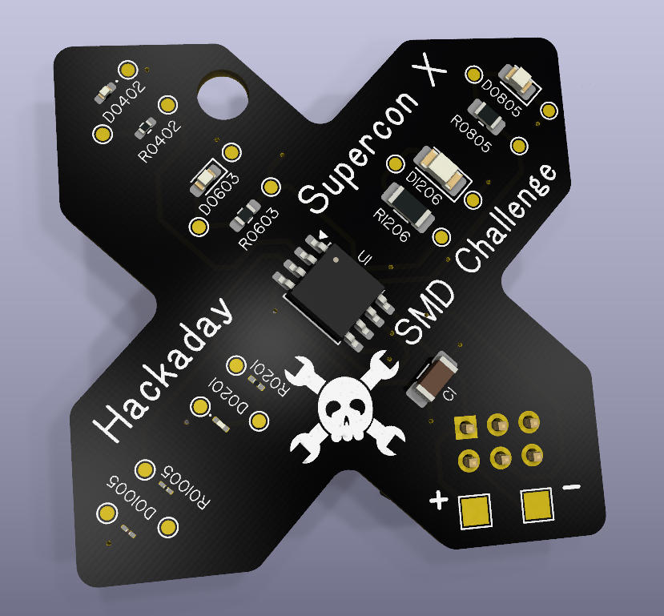
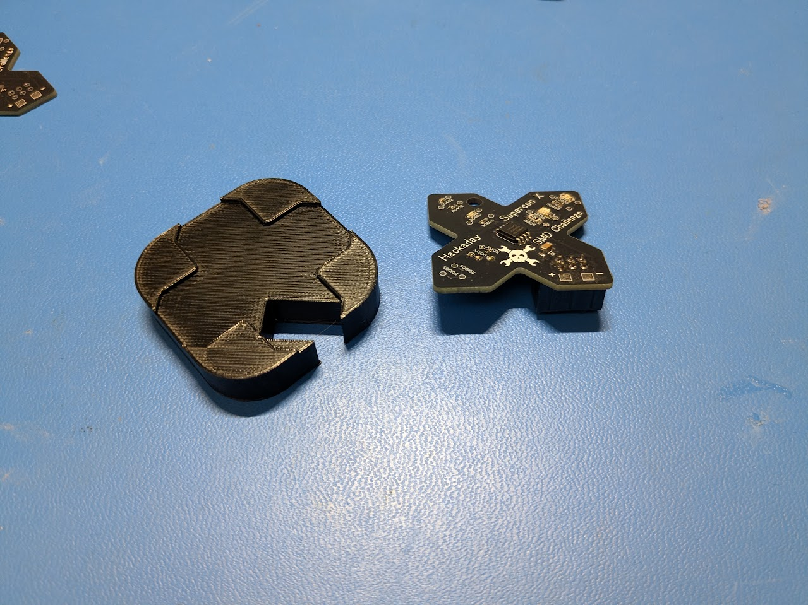
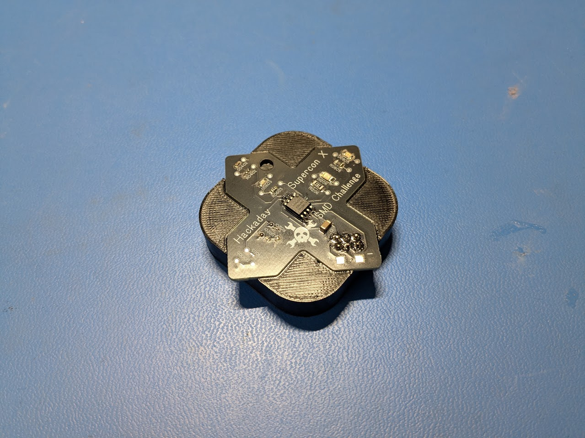

# SuperconSMDChallenge2026

The Hackaday Supercon X SMD Challenge board is here and it's an SAO for your badge!

Featuring parts from 1206 down to the insane 01005!

Since the SAO version of the board can't be worked on with the connector attached, a 3D-printable work stand STL file is included.

